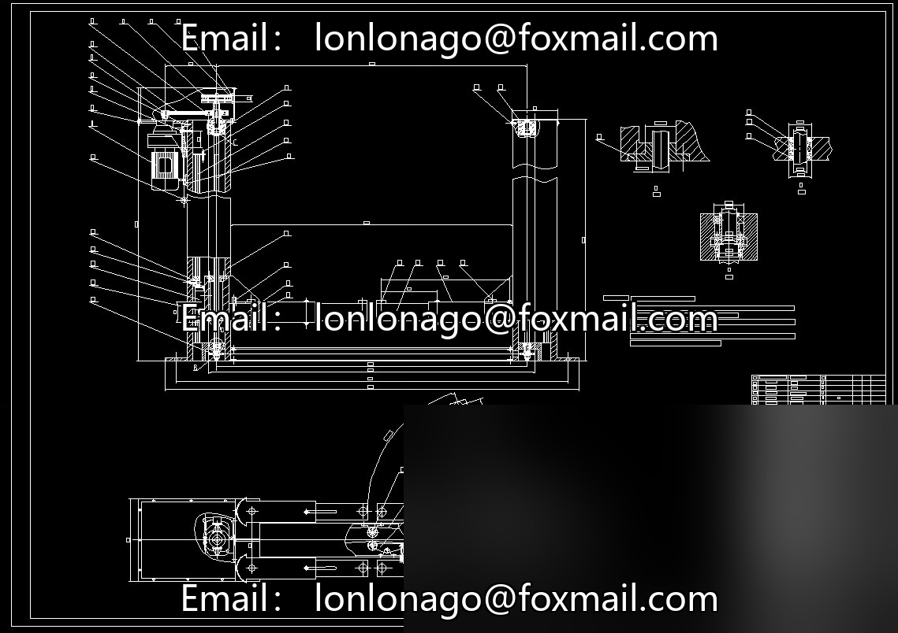
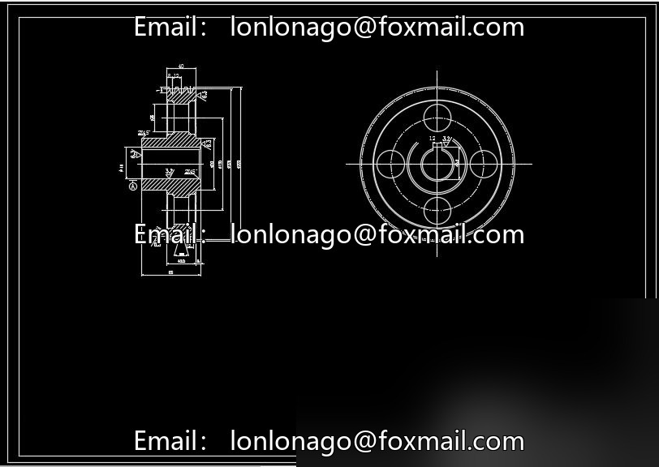
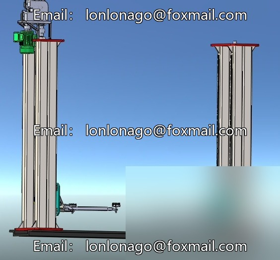
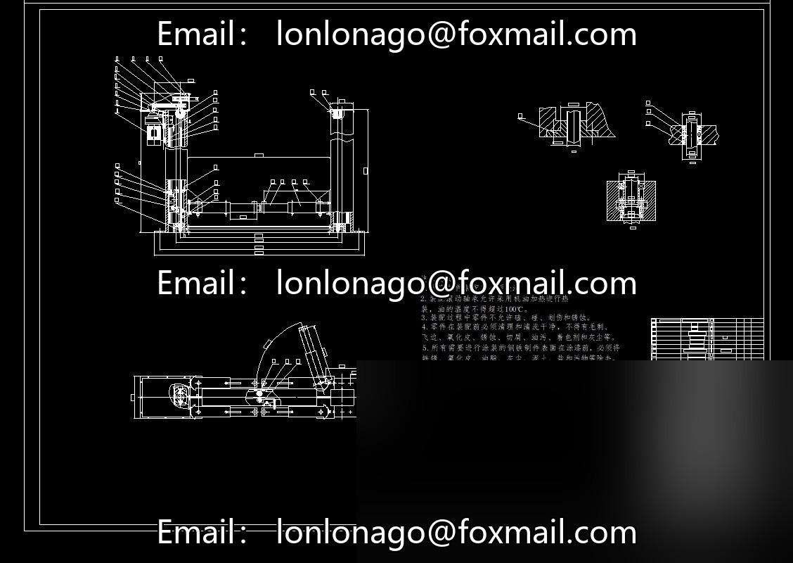

# Lift machine design, double column lift machine design, lift machine structural design, double column car lift machine design

## Body

Lift machine design; double-column lift machine design; lift machine structural design; double-column automobile lift machine structural design; double-column mechanical lift machine structural design; lift machine design CAD drawings
This document contains two sets of reference images, including assembly drawings and part drawings.
Additionally, a dual-column lift device 3D model is included, referencing Figure 3D.
34

The material covers lifting machine design, dual-column lifting machine structure and mechanical design, including CAD drawings, reference drawings, assembly drawings, parts drawings, a dual-column lifting machine 3D model and reference figures, with two reference sets provided.

<!-- AI_ENRICHED -->

## Images

## Payment

Here is a pay link on Stripe ( https://buy.stripe.com/3cs8yP7sY87d0vu9AB ). Please contact me lonlonago@foxmail.com after funding $89, and I will send you a complete data files , thank you!

